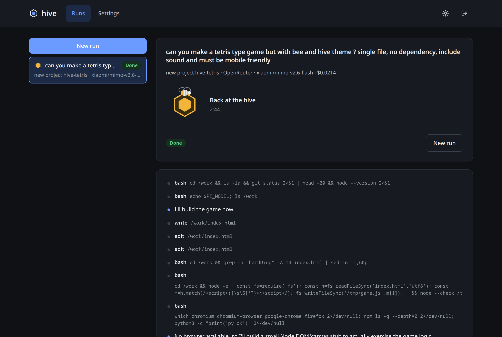
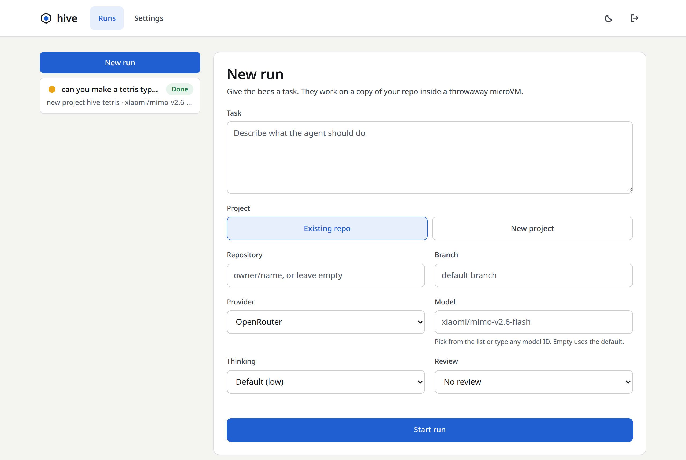
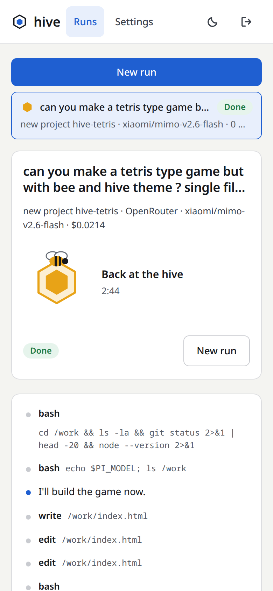

# Agent Hive 🐝

**Run a coding agent on your repo inside a throwaway microVM.**

Give `hive` a task. A coding agent ([pi](https://pi.dev), on the model you choose) works on a copy
of your repo inside its own small virtual machine: it can install packages, run builds and tests,
open a headless browser and commit, but it can't touch the rest of your computer. Its commits come
back as patches you review before anything reaches your repo or GitHub.



```bash
cd ~/code/my-app
hive run "add input validation to the signup form"
hive diff          # review what it did
hive apply         # take the changes into your working tree
hive push --pr     # or push a branch and open a pull request
```

- **Isolated:** every run boots its own microVM ([libkrun](https://github.com/containers/libkrun))
  with its own kernel, and a network that reaches the internet only through a proxy hive runs,
  which refuses your computer and your local network (router, NAS, other devices).
- **Nothing secret goes in:** the VM gets the repo copy and one LLM API key. Your SSH keys, GitHub
  login and other files stay outside.
- **You stay in control:** results come back as patches. Nothing is pushed or opened on GitHub
  until you say so.
- **Terminal or browser:** the `hive` CLI, or a web UI you can also use from your phone.
- **Any model:** DeepSeek, Z.AI, OpenRouter, Anthropic or OpenAI.

## Requirements

- **Linux** with KVM (`/dev/kvm`): a regular PC or a server with virtualization enabled.
- **pasta**, from your distro's `passt` package when it has one: `sudo apt install passt` (Debian,
  Ubuntu, Mint), `sudo dnf install passt` (Fedora, RHEL) or `sudo pacman -S passt` (Arch). Release
  installs prefer it but also bundle a static pasta fallback for distros without a package (Ubuntu
  22.04, Debian 11, RHEL 8), so they need only KVM: libkrun is bundled too.
- Building from source also needs the system **libkrun** (Fedora: `sudo dnf install libkrun`).
- An API key for at least one model provider.

Tested on Fedora 45 and Linux Mint 22.1, and in Ubuntu 22.04 and 24.04 containers.

Windows: WSL2 (any distro, with nested virtualization) should work with the release, but hasn't
been tested yet; a one-line PowerShell installer is next on the [roadmap](docs/ROADMAP.md#step-1b--windows-through-wsl2-next).
macOS is on the roadmap too.

## Install

**From a release** (Linux x86_64):

```bash
curl -fsSL https://raw.githubusercontent.com/ogsapps/agent-hive/main/install-cli.sh | sh
```

The release brings its own Node.js and downloads the VM filesystem. `hive update` installs newer
releases after checking their signature. `hive update --channel beta` follows the daily signed
prereleases instead.

**From source** (also needs Node.js 20+, git and podman):

```bash
git clone https://github.com/ogsapps/agent-hive.git && cd agent-hive
npm ci && npm run build && npm run build:ui
npm run build:image && npm run build:vm && npm run build:rootfs
npm link            # puts `hive` on your PATH
```

Then check everything is in place and add a key:

```bash
hive doctor
hive keys add openrouter      # or deepseek, zai, anthropic, openai
```

## Using it

```bash
cd ~/code/my-app
hive run "fix the off-by-one in the pager"       # live progress in the terminal
hive continue "also add a test for it"           # follow up in the same session
hive diff                                        # review
hive apply                                       # into your working tree, uncommitted
hive push --pr                                   # or a hive/<run> branch + pull request
```

Work on a GitHub repo without a local checkout, or start a new project:

```bash
hive run --repo owner/name "update the README for the new flags"
hive new my-game "a bee-themed falling-block game in one HTML file"
```

Save the result instead of pushing it:

```bash
hive export              # a zip of the project files
hive export --report     # a Markdown report: the prompt, the agent's report, the commits
```

| Command | |
|---|---|
| `hive run "<task>"` | Run the agent on the current repo (or `--repo owner/name`) |
| `hive new <name> "<task>"` | Start a new project from an empty repo |
| `hive continue "<task>"` | Follow up on the last run |
| `hive list` / `hive log` | Your runs / a run's events |
| `hive diff` / `hive apply` | Review / take the changes |
| `hive push [--pr]` | Push a branch, optionally open a pull request |
| `hive export [--report]` | Save a zip or a report |
| `hive keys` | Manage provider keys |
| `hive serve` | Start the web UI |
| `hive doctor` | Check the setup |

Options like `-m <model>`, `-p <provider>` and `--review <n>` (review cycles by a second agent
pass) are in the [CLI reference](docs/CLI.md).

## Web UI

```bash
hive serve                  # opens http://127.0.0.1:8080/ui/ in your browser
hive service install        # or keep it running in the background
```

Start runs on your GitHub repos or new projects, watch the agent work live, send follow-ups, open
pull requests and download results, from the browser or your phone. Runs from the web UI and the
terminal share one list. Details in [docs/SERVER.md](docs/SERVER.md).

<p>
  
  
</p>

## How it works

```
your repo ──clone──► work/ ──► microVM: pi edits, runs, commits ──► patches ──► you: diff · apply · push
                               (sees only work/, the prompt, one key)
```

hive copies your repo into a run folder and boots a microVM that sees only that copy. Inside, the
agent has free rein. Text crosses the boundary only as files: the prompt goes in, an event log and
patches come out. The host never runs git inside the agent's copy, so nothing the agent puts in
`.git` can run on your machine. A time limit, a stall watchdog, a disk limit and a deadline note
keep runs from running away, and committed work is kept even if a run fails.

The full picture is in **[How it works](docs/HOW-IT-WORKS.md)**.

## Docs

- [How it works](docs/HOW-IT-WORKS.md): the design, the isolation, and what happens during a run
- [CLI reference](docs/CLI.md): every command and option
- [Configuration](docs/CONFIGURATION.md): settings, providers and models, OpenRouter routing
- [Web UI and server](docs/SERVER.md): `hive serve`, running it as a service, the API
- [Roadmap](docs/ROADMAP.md): what's next (releases, more platforms)
- [AGENTS.md](AGENTS.md): code layout and the security rules, for contributors and coding agents

## Development

```bash
npm test                     # builds and runs the tests in a throwaway temp folder
npm run build:ui             # rebuild the web UI
```

The code layout and the security invariants the code relies on are in [AGENTS.md](AGENTS.md).

## Built with AI assistance

Much of Agent Hive's code and documentation was written with AI coding assistants, including
coding agents running inside hive itself. The design decisions, reviews and testing on real
machines are done by its maintainer. Bug reports and pull requests are welcome either way.

## Thanks

Agent Hive is a thin layer over some excellent open-source projects. Thank you to everyone who
builds and maintains them:

- **[pi](https://pi.dev)**: the coding agent that does the actual work inside each VM. hive's whole
  design (a prompt file in, a JSON event log out) leans on pi's headless mode.
- **[libkrun](https://github.com/containers/libkrun)** and
  **[libkrunfw](https://github.com/containers/libkrunfw)**: the library that boots a microVM in a
  few hundred milliseconds, and the small Linux kernel it runs, from the
  [containers](https://github.com/containers) project.
- **[passt / pasta](https://passt.top)**: rootless networking that gives each VM its one way out,
  to that proxy, without root.
- **[Fedora](https://fedoraproject.org)**: the base of the VM's filesystem, which also packages
  libkrun and passt.
- **[Chromium](https://www.chromium.org)**, **[Node.js](https://nodejs.org)** and
  **[git](https://git-scm.com)**: inside every VM, and behind half of what the agent does.
- **[Fastify](https://fastify.dev)**, **[Vite](https://vite.dev)**,
  **[esbuild](https://esbuild.github.io)** and **[TypeScript](https://www.typescriptlang.org)**:
  the server, the web UI build and the release bundle.

Their licenses and the full list are in [docs/THIRD-PARTY.md](docs/THIRD-PARTY.md).

## License

[MIT](LICENSE).
